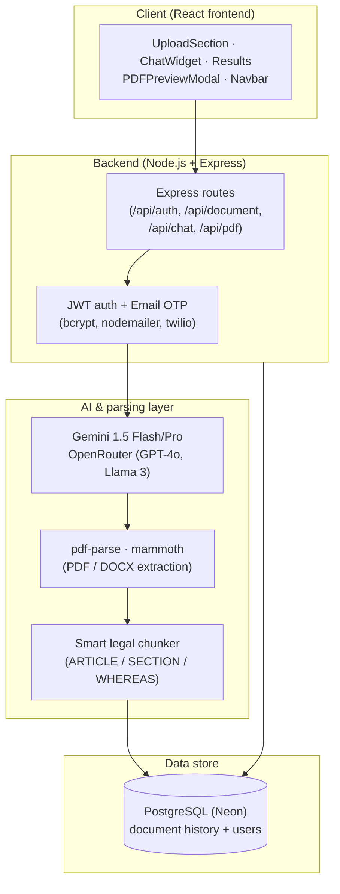

# LegalEaseAI

[](src)
[](backend)
[](backend/database)
[](backend/services)
[](LICENSE)

> **Advanced Full-Stack Legal Document Analyzer & Conversational Assistant**

LegalEaseAI is an enterprise-grade legal document analysis platform. It leverages state-of-the-art Large Language Models (LLMs) to ingest complex contracts, leases, and agreements, extract key clauses, detect risk factors, and provide plain-English explanations. The application features an interactive chatbot that allows users to converse directly with their documents in a secure, contextual sandbox.

---

## 🌟 Key Capabilities

* **Intelligent Document Parsing**: Automatically extracts readable text from **PDF** and **Word (DOCX)** documents, as well as raw text inputs.
* **Semantic Analysis & Clause Extraction**: Analyzes agreements at the clause level to detail original text, plain-language explanations, risk assessment levels (`Low`, `Medium`, `High`), and custom negotiation suggestions.
* **Proactive Red Flag Detection**: Isolates critical issues, liability exposures, and unfavorable terms with severity warnings, potential consequences, and actionable recommendations.
* **Contextual AI Chatbot**: A chat interface that maintains state and utilizes document content to answer specific follow-up questions, define legal jargon, and simulate negotiation scenarios.
* **Secure Document Chunking**: Pre-processes massive documents by identifying legal section boundaries (e.g., `ARTICLE`, `SECTION`, `WHEREAS`), ensuring long documents fit within model limits without losing context.
* **Interactive Document Preview & PDF Export**: Generates professional PDF summaries and structured reports directly from the web interface.

---

## 🛠️ Tech Stack & Architecture

### Frontend Architecture
* **Library**: React 18
* **Styling**: Tailwind CSS (Premium Dark/Light mode support)
* **Animations**: Framer Motion (Fluid transitions and micro-interactions)
* **Client-Side Export**: `html2canvas` & `jspdf` for high-fidelity PDF generation

### Backend & AI Infrastructure
* **Framework**: Node.js & Express
* **Database**: PostgreSQL (Neon Serverless Integration)
* **Auth & Security**: Email OTP (One-Time Password) generation, JWT tokenization, and bcrypt secure hashing
* **Parsing Utilities**: `pdf-parse` (for PDF text extractions) and `mammoth` (for DOCX extraction)
* **LLM Providers**:
  * **Google Gemini (Direct SDK)**: Native integration using `@google/generative-ai` supporting **Gemini 1.5 Flash** (high speed, cost-effective) and **Gemini 1.5 Pro** (advanced reasoning).
  * **OpenRouter (API)**: Unified router access supporting **OpenAI GPT-4o-mini**, **GPT-4o**, and **Meta Llama 3**.

---

## Architecture Overview



## 📂 Repository Structure

```text
LegalEaseAI/
├── src/                        # React Frontend Application
│   ├── components/             # UI Components
│   │   ├── ChatWidget.js            # Floating conversational assistant
│   │   ├── ClauseAccordion.js       # Clause-by-clause analysis collapse component
│   │   ├── EnhancedAuthModal.js     # OTP and credential sign-in/up modal
│   │   ├── Footer.js                # Footer layout with legal disclaimers
│   │   ├── InfoModal.js             # Info modal wrapper for policy contents
│   │   ├── ModalContent.js          # Raw HTML/Markdown policies (Privacy, Terms)
│   │   ├── Navbar.js                # Top navigation header with dark mode toggle
│   │   ├── PDFPreviewModal.js       # Export and print preview portal
│   │   ├── PDFTemplate.js           # Print-friendly layout template
│   │   ├── RedFlagSidebar.js        # Severe risk item sidebar
│   │   ├── ResultsSection.js        # Main document results panel
│   │   ├── SummaryCard.js           # Executive summary & quick stats display
│   │   └── UploadSection.js         # File drag-and-drop / raw text uploader
│   ├── services/               # Client-Side Service Handlers
│   │   ├── BackendPDFAPI.js         # Backend PDF converter connector
│   │   └── PDFService.js            # Client-side PDF formatting
│   ├── App.js                  # App controller, context providers & routing
│   ├── index.js                # DOM mount entrypoint
│   └── index.css               # Global tailwind imports & CSS variables
│
├── backend/                    # Node.js Express API Server
│   ├── config/                 # Configurations (PostgreSQL Pool)
│   ├── controllers/            # Controller layer (auth, history controllers)
│   ├── database/               # Init scripts and database schema files
│   ├── middleware/             # Express middlewares (JWT Authenticator)
│   ├── migrations/             # SQL database table migration configurations
│   ├── routes/                 # Express Router files
│   ├── services/               # Core services (AI generation, Email, Twilio OTP)
│   ├── utils/                  # Utility functions (Smart chunker, prompts)
│   └── index.js                # Main server entrypoint
```

---

## ⚙️ Setup and Installation

### 1. Prerequisites
Ensure you have the following installed on your machine:
* **Node.js** (v18.x or higher)
* **npm** (v9.x or higher)
* **PostgreSQL Database** (Optional: required only for document history preservation)

### 2. Environment Variables Configuration
Configure your backend environment. Create a `.env` file in the `/backend` directory based on the template:

```env
PORT=5000
NODE_ENV=development

# Database Configuration (PostgreSQL)
DATABASE_URL=postgresql://<username>:<password>@<host>:<port>/<database>

# JWT Authentication
JWT_SECRET=your_strong_jwt_secret_key

# SMTP Credentials (For OTP Emails)
SMTP_HOST=smtp.gmail.com
SMTP_PORT=587
SMTP_USER=your_email@gmail.com
SMTP_PASS=your_gmail_app_password

# LLM Providers Configuration (Configure at least one)
OPENAI_ROUTER_KEY=your_openrouter_api_key
GEMINI_API_KEY=your_google_gemini_api_key
```

### 3. Installation
Install all package dependencies for the root, frontend, and backend components automatically:
```bash
npm run install-all
```

### 4. Running Locally
Run both the frontend client and the backend server concurrently in development mode:
```bash
npm run dev
```

* **Frontend Application**: `http://localhost:3000`
* **Backend Server API**: `http://localhost:5000`

---

## 📡 Backend API Reference

### Authentication
* `POST /api/auth/send-otp` - Dispatch email verification code.
* `POST /api/auth/verify-otp` - Validate OTP and generate a JWT access token.

### Document Management & Analysis
* `POST /api/document/analyze-file` - Upload file (PDF, DOCX) via multipart/form-data for full AI analysis.
* `POST /api/document/analyze-text` - Analyze raw pasted text.
* `POST /api/document/chat` - Interact with the current document using the conversational chatbot.
* `GET /api/document-history` - Retreive the current user's document history list.

### Document Export
* `POST /api/pdf/generate` - Generate formatted export documents.

## ✅ Verification Status

Verified in this audit:

| Check | Result |
| --- | --- |
| Backend `npm ci` | PASS |
| Backend smoke (`node index.js`, limited mode, no DB) | `GET /` 200, `GET /health` 200 — server starts and degrades gracefully without `DATABASE_URL` |
| Frontend `npm ci` | PASS |
| Frontend `npm run build` | PASS — production `build/` output generated |

Fixes applied to unblock the production build:
- Removed unused icon imports (`PDFTemplate.js`: `ClockIcon`, `ScaleIcon`, `ExclamationTriangleIcon`, `CheckCircleIcon`; `PDFPreviewModal.js`: `Cog6ToothIcon`; `SummaryCard.js`: `PrinterIcon`; `Navbar.js`: unused `useEffect`)
- Removed dead function `handleSwitchAuthMode` (`App.js`)

Note: with `CI=true` forced, `react-scripts build` elevates two pre-existing warnings to errors (unused `handleSwitchAuthMode` — removed; `useEffect` exhaustive-deps in `ChatWidget.js`). The repo has no CI workflow; the standard `npm run build` passes. The `ChatWidget.js` hook dependency was left untouched because adding it "by the book" risks a render loop (the effect writes to state it reads).

---

## ⚠️ Disclaimer

LegalEaseAI provides AI-generated contract summaries, insights, and risk assessments for **educational and helper purposes only**. It does not constitute professional legal advice, nor does it create an attorney-client relationship. Always consult a qualified attorney for formal legal matters.